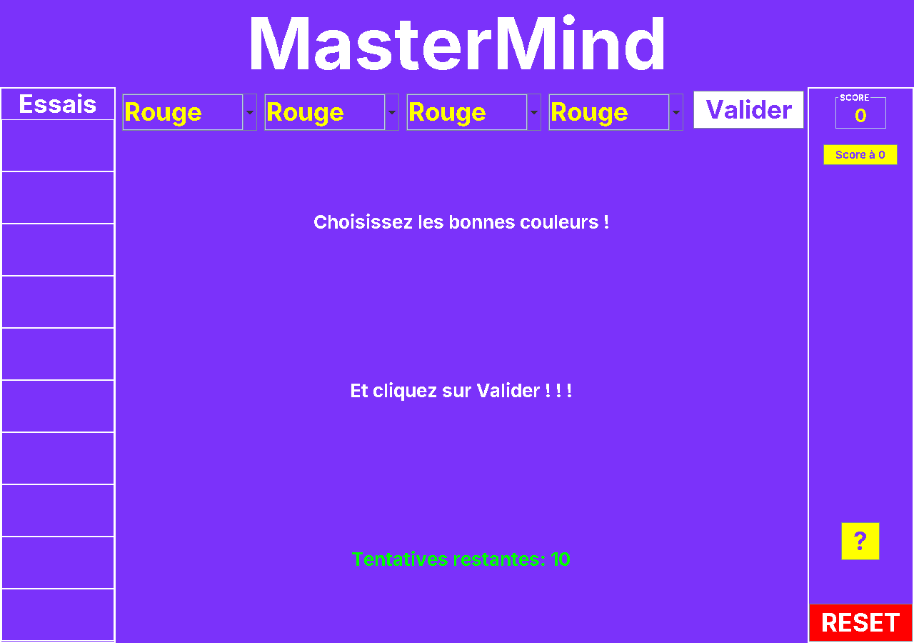

# Mastermind

Jeu de Mastermind en **Java Swing**, réalisé pour l'examen de Principes algorithmiques et
programmation (1re année du Bachelier en informatique de gestion, EAFC, juin 2023).



## Règles

L'ordinateur tire un code secret de 4 couleurs parmi 6 (une couleur peut apparaître plusieurs fois).
Vous avez 10 essais. Après chaque essai, le jeu indique :

- **V** : le nombre de pions de la bonne couleur et à la bonne place ;
- **C** : le nombre de pions de la bonne couleur mais mal placés.

Le score récompense les indices obtenus et une victoire rapide, et pénalise un échec.

## Lancer le jeu

Prérequis : **JDK 17 ou plus récent**.

```bash
# Windows
build.bat
# Linux / macOS
./build.sh

java -jar mastermind.jar
```

Le script compile le jeu, exécute les tests de `test/mastermind/EvaluationTest.java`, puis crée le jar.

## Historique

- Le tag [`examen-juin-2023`](../../tree/examen-juin-2023) correspond au code rendu à l'examen.
- Corrections faites lors de la mise sur GitHub :
  - gagner au 10e essai provoquait une `NullPointerException` (9 cases d'historique sur 10) ;
  - les couleurs mal placées étaient mal comptées quand une couleur était répétée. Par exemple,
    l'essai Rouge-Rouge-Rouge-Rouge contre le secret Rouge-Vert-Bleu-Jaune donnait 1 + 3 au lieu de 1 + 0 ;
  - nettoyage : package, génériques, police, chargement des images.

---
Martin Buchet
